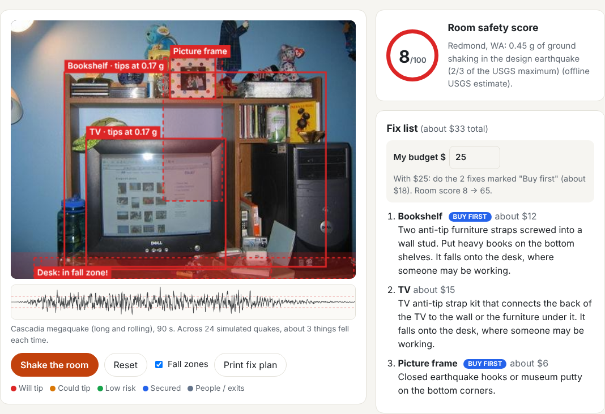
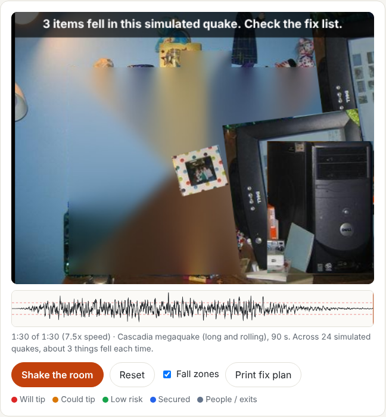

# QuakeReady

QuakeReady scans a photo of a room, finds the furniture that would tip over or fall in a Pacific Northwest earthquake, and shows you exactly how to secure each one.

It combines open-vocabulary object detection (YOLOE / YOLO-World), real tip-over physics, and USGS seismic hazard data for your address. Then it rocks every object through 24 simulated Cascadia or Seattle Fault earthquakes (Housner's rocking-block model) to find how often it actually falls, animates your own photo shaking along with a seismograph, and picks the fixes that help most for your budget.

Built by Aaditya Saini (Redmond High School) for the 2026 Congressional App Challenge, WA-01.





## Run it

**Use 64-bit Python 3.11 or 3.12.** PyTorch, OpenCV and NumPy ship ready-made packages ("wheels") for these versions. With a brand-new Python, a 32-bit Python or an ARM build on Windows, pip may try to compile NumPy from source and fail with "Unknown compiler(s)".

Check what you have. The second value should be `win-amd64` on Windows (or `macosx-...` / `linux-x86_64` elsewhere):

```
python -c "import sys, sysconfig; print(sys.version.split()[0], sysconfig.get_platform())"
```

(On Windows on ARM, `platform.machine()` reports `ARM64` even inside an emulated x64 Python, so check `sysconfig.get_platform()` instead.)

Download the project (green **Code** button, then **Download ZIP**, and unzip it) or clone it with Git. Then open a terminal inside the `quakeready` folder (the one that contains `app` and `static`).

### Windows (PowerShell)

Install **Python 3.12 (Windows installer, 64-bit)** from python.org if you don't have it. It can sit alongside other versions.

> **Windows on ARM (Snapdragon / Surface laptops):** PyTorch and OpenCV don't publish Windows ARM64 packages, so an ARM64 Python can't install them. Install the **x64** ("64-bit", not "ARM64") Python 3.12 installer anyway. Windows runs it through built-in emulation. After creating the venv below, the version check above must print `win-amd64`, not `win-arm64`.

Then:

```powershell
cd quakeready
py -3.12 -m venv .venv
.venv\Scripts\Activate.ps1
python -m pip install --upgrade pip
python -m pip install --only-binary=numpy,torch,torchvision,opencv-python -r requirements.txt
python -m uvicorn app.main:app --reload
```

* `--only-binary=...` tells pip to use ready-made packages for the big compiled libraries and never try to compile them. If it says "No matching distribution", your Python version or architecture is the problem, not the package.
* The last line of `requirements.txt` installs `clip` (the text encoder library Ultralytics needs) from a GitHub zip, so you don't need Git. If you see `ModuleNotFoundError: No module named 'clip'`, rerun the install line above.
* Already made a `.venv` with the wrong Python? Delete it first with `Remove-Item -Recurse -Force .venv`, then rerun the steps.
* `py -0` lists the Python versions installed. If `py` isn't found, install Python from python.org and tick **Add python.exe to PATH**.
* If activation fails with "running scripts is disabled on this system", run this once in the same window, then activate again:
  `Set-ExecutionPolicy -Scope Process -ExecutionPolicy Bypass`
* Using Command Prompt (cmd) instead of PowerShell? Activate with `.venv\Scripts\activate.bat`.
* Next time, just activate and start the server, or double-click `run.bat`.

### Mac or Linux

```bash
cd quakeready
python3.12 -m venv .venv          # or python3.11
source .venv/bin/activate
python -m pip install --upgrade pip
python -m pip install --only-binary=numpy,torch,torchvision,opencv-python -r requirements.txt
python -m uvicorn app.main:app --reload
```

Next time, just run `./run.sh`.

### Then

Open http://127.0.0.1:8000, pick a sample photo (or your own), and press **Scan room**. Stop the server with Ctrl+C.

When the virtual environment is active, your prompt starts with `(.venv)`. If you see "No module named uvicorn" or "No module named app", check that the environment is active and that you're inside the `quakeready` folder.

The first scan downloads the detection model (about 60 MB) and its text encoder (about 570 MB, one time only), so give it a few minutes. After that, a scan takes about a second on a laptop. The downloaded model files are saved in whatever folder you start the server from.

Run the physics tests with `python -m pytest` (same on every system).

## How it works

```
photo ─► open-vocabulary YOLO ─► clean up boxes ─► size in inches ─► tip-over physics ─► fall zones ─► rocking simulation ─► score + fix list + budget plan
                                                                         ▲                                     ▲
                              address ─► geocode ─► USGS design PGA ─────┘  (× floor amplification)           │
                                                    quake type (Cascadia / Seattle Fault) ─► 24 synthetic quakes ┘
```

| Step | File | Idea |
|---|---|---|
| Detect | `app/detector.py` | YOLOE or YOLO-World finds objects you name in text, so it can find bookshelves and water heaters that normal COCO-trained YOLO can't. |
| Facts | `app/hazards.py` | Typical size, depth, center of mass, severity and fix for each kind of object. |
| Measure | `app/measure.py` | A door (80 in) or the median of every object's typical size sets pixels per inch. |
| Physics | `app/physics.py` | A block tips when floor acceleration > g × (D/2) / h_com, which is g × D/H for a uniform box. Upper floors shake more: × (1 + 2z/h), from ASCE 7. |
| Shaking | `app/shaking.py` | Address → lat/lon (Census, then OpenStreetMap) → USGS ASCE 7-22 web service → peak ground acceleration. Offline fallback for WA-01 cities. |
| Rocking | `app/rocking.py` | Makes 24 synthetic earthquakes (filtered noise with an envelope, scaled to the USGS shaking) and solves Housner's rocking-block equation for every object. Counts how often each one falls. |
| Plan | `app/planner.py` | 0/1 knapsack (dynamic programming): the fixes that raise the room score most within your budget. |
| Pipeline | `app/analyze.py` | Ties it together, finds fall zones, checks whether they cover a bed, couch, desk, crib or door, and inpaints a background for the animation. |
| Server | `app/main.py` | FastAPI routes: `/api/analyze`, `/api/recalculate`, `/api/shaking`. |
| Front end | `static/` | Plain HTML, CSS and JavaScript. Canvas drawing, editable items, the seismograph, the shake animation (a playback of the simulation) and a print layout. |

## Limits (be upfront about these)

* One photo has no true depth. Furniture depth comes from typical sizes, and the user can type in real measurements.
* A single scale for the whole photo ignores perspective. Objects far from the camera are underestimated.
* The tip threshold is the shaking needed to *start* rocking. The rocking simulation then estimates whether it falls, treating furniture as a rigid box that rocks freely (no wall behind it, no sliding).
* The simulated quakes are synthetic, shaped like real ones and scaled to USGS values. Cascadia is shortened to 90 seconds; real shaking could last 3 to 5 minutes, so the real risk may be higher.
* The detector makes mistakes. Every item has a "Not a ..." button.

## Ideas for 2.0

* Live AR fall zones on a phone (ARKit / ARCore give real depth).
* A monocular depth model (Depth Anything V2 metric indoor) to measure each object at its own distance.
* Real recorded ground motions (for example the 2001 Nisqually quake) alongside the synthetic ones.
* Model the wall behind furniture, sliding, and the building filtering the shaking.
* Whole-home score across rooms, ranked by risk removed per dollar.
* Spanish and other languages; a version for school classrooms.

## Data sources

* USGS Seismic Design Maps web service, ASCE 7-22: https://earthquake.usgs.gov/ws/designmaps/asce7-22.html
* U.S. Census Bureau geocoder and OpenStreetMap Nominatim
* FEMA E-74, *Reducing the Risks of Nonstructural Earthquake Damage*
* Housner, G. W. (1963), "The behavior of inverted pendulum structures during earthquakes", *Bulletin of the Seismological Society of America* 53(2)
* Kanai (1957) and Tajimi (1960) ground-motion filter; Clough and Penzien, *Dynamics of Structures*
* Earthquake Country Alliance, *Secure Your Space*
* Sample photos: COCO 2017 dataset images (from Flickr, under various Creative Commons licenses), via Ultralytics coco128.

Full APA citations are in [CITATIONS.md](CITATIONS.md).

## Credits

* Code walkthrough for readers: [WALKTHROUGH.md](WALKTHROUGH.md).
* Built with help from Claude, an AI assistant by Anthropic.
* Object detection: Ultralytics YOLOE / YOLO11 (AGPL-3.0) with CLIP / MobileCLIP text encoders. Model weights are downloaded on first run and are not stored in this repository.
* Seismic data: U.S. Geological Survey (public domain). Geocoding: U.S. Census Bureau and OpenStreetMap contributors (ODbL).
